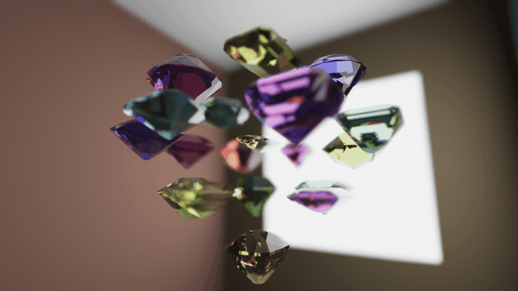
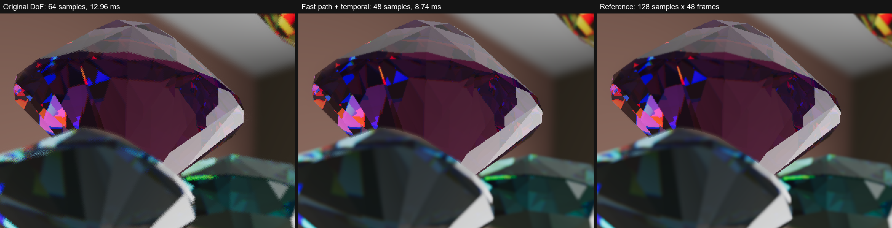
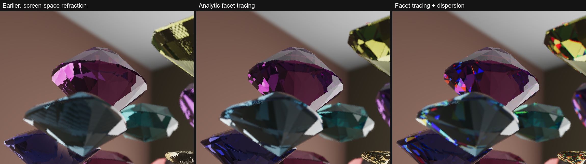

# Depth of Field Gems

A high-quality, physically motivated **depth of field** for the [Defold](https://defold.com)
engine, shown on a cluster of refractive gems in a lit room.



*6-second camera orbit, captured frame by frame at 1920×1080 in real-time mode: one engine frame
per video frame, so the moving camera looks exactly as it does for a player. The GIF is
downscaled; the [full-resolution still](docs/screenshot.jpg) shows the actual quality.*

## Why another depth of field

Most game DoF splits the scene into a few depth planes and blurs each one. That is cheap, but
it smears sharp objects into blurred ones, cuts blurred foreground off at sharp edges and makes
bokeh look like a soft haze. This demo evaluates the lens blur per pixel instead:

- **Scatter-as-gather.** Every pixel is a light source that spreads into its own disk, the
  circle of confusion. A pixel collects samples over a Fibonacci-spiral disk kernel, and each
  sample is weighted by the blur radius **of the sample's own source**: a blurred foreground
  spreads over a sharp background, while a sharp object never leaks into its blurred
  surroundings.
- **Normalized kernel.** Inside its disk a source falls off linearly from the center, and the
  cone is normalized so it integrates to one: a defocused highlight spreads into a larger, dimmer
  disk instead of simply getting softer.
- **Five depth layers.** Samples are sorted into far, mid-far, current, mid-near and near layers
  relative to the pixel. Each layer is resolved on its own and the layers are composited back to
  front, so occlusion between blurred and sharp depths stays correct.
- **HDR throughout the blur**, ACES tone mapping only at the very end, and an autofocus that
  follows the gem in the center of the view.

## How it is made fast without changing the result

The straightforward version of this (`shaders/dof_present.fp`, still used as the fallback) takes
most of the frame. Two layers of optimization make it substantially cheaper, and each was
checked against the original rather than eyeballed. With the default settings (28 px maximum blur
radius) at 2560×1440:

| Path | Frame time |
|---|---:|
| Original single pass, 64 samples | 12.50 ms |
| Fast path, 64 samples | 10.66 ms |
| **Fast path + temporal accumulation, 48 samples (default)** | **9.31 ms** |

### 1. Fast path: same samples, fewer of them

```
scene (RGBM + depth)
  -> dof_prepare      unpack once: RGBA16F, rgb = HDR color, a = linear depth
  -> dof_tile_max     16x16 tiles: maximum blur radius inside each tile
  -> dof_tile_dilate  maximum over neighboring tiles: how far any blur can reach a pixel
  -> dof_gather       the gather, iterating only over samples that can contribute
```

- After `dof_prepare` a sample costs **2 texture reads** (hardware-filtered color, depth)
  instead of 5 reads, 4 HDR decodes and a matrix multiply.
- Sample radii on the Fibonacci spiral grow with the sample index, and a sample can only receive
  energy from a source whose blur radius exceeds its distance. So each pixel stops at the first
  sample beyond the dilated tile radius; every skipped sample would have had zero weight.
- Positions, rotation and weights of the samples are unchanged. With a fixed kernel the fast path
  matches the original pass **bit for bit on 94.5% of pixels** and differs by more than 2/255 on
  0.006% of them (half-float rounding).

### 2. Temporal accumulation: more samples over time, honestly

- Every frame uses a new kernel rotation (interleaved gradient noise in space, a golden-ratio
  sequence in time) and slides the sample rings within their area bands. A fixed set of rings
  would converge to a fixed quadrature; sliding rings converge to the actual integral over the
  lens disk.
- While the image is static, frames are averaged (exactly for the first 32 frames, then as an
  exponential moving average over about 32 frames) **with no clamping at all**, so the result is
  not biased towards the current frame's noise.
- When the image changes (the camera moves, the focus shifts or a slider is dragged), history is
  reprojected by depth, clamped to the 3×3 neighborhood's mean ± 1.25 σ and limited to 8 frames,
  which keeps moving edges free of ghosting.

### Accuracy and cost

Because the layered blur is non-linear, the number of samples per frame still matters after
accumulation. All numbers are measured against a reference of 128 sliding-ring samples per frame
averaged over 48 frames (share of pixels with an error above 5/255). This study was made with a
16 px maximum blur radius, the default at the time:

| Configuration | Single frame | Persistent bias | Frame time |
|---|---:|---:|---:|
| Original pass, 64 samples | 4.60% | 0.90% | 12.96 ms |
| Fast path, 64 samples | 4.59% | 0.81% | 9.63 ms |
| Fast path + temporal, 24 samples | 2.01% | 1.71% | 6.95 ms |
| Fast path + temporal, 32 samples | 1.42% | 1.15% | 7.55 ms |
| **Fast path + temporal, 48 samples (default)** | **0.79%** | **0.67%** | **8.74 ms** |
| Fast path + temporal, 64 samples | 0.45% | 0.40% | 9.92 ms |

With the default 48 samples, every single frame is closer to the reference than the original
pass averaged over 48 frames, and it renders faster.



*2× zoom, single frames, 16 px maximum blur radius.*

Frame times are whole-frame medians without vsync at 2560×1440 (a 1280×720 window on a 200%
display), NVIDIA GeForce RTX 5060 Ti, Defold 1.14.0, OpenGL on Windows. They include the scene
itself, about 5 ms.

## The scene

Everything is computed in shaders every frame, with no scene textures and no baked lighting.

- **The room** (`shaders/room.fp`) is a fullscreen pass: each pixel intersects its view ray with
  the cube and shades the hit point with the exact irradiance of two rectangular window lights
  plus a cheap indirect term. It also writes the hardware depth the DoF needs.
- **The gems** (`shaders/gem.fp`) are traced analytically. Each cut is a convex polyhedron of
  31–94 facet planes extracted offline by `tools/extract_gem_planes.py`. The refracted ray is
  intersected with the planes inside the gem, light splits at every facet by the Fresnel
  equations with total internal reflection (up to 5 bounces), Beer–Lambert absorption gives the
  body color, and three traces with different indices of refraction for red, green and blue
  produce the dispersion ("fire").



## Running

1. Install [Defold 1.14.0](https://defold.com/download/) or newer.
2. Open `game.project` and choose **Project → Build** (Ctrl+B).
3. Drag with the mouse to orbit the camera. **Expand settings** under the FPS counter opens
   sliders for the blur, the lighting and the gem absorption.

The project has no dependencies and no native extensions. It also builds for the web
(`bob --platform wasm-web`); see [ENGINE.md](ENGINE.md) for the shader constraints this
imposes. The web build compiles but has not been tested in a browser yet.

If the device cannot render to RGBA16F, the renderer falls back to the original single-pass DoF
automatically and logs which path it uses.

## Configuration

All settings live in [`config/consts.lua`](config/consts.lua), each with a comment. The main
depth of field settings:

| Setting | Default | Meaning |
|---|---|---|
| `DOF_FOCUS_DISTANCE` | `0` | Focus distance; `0` = autofocus on the gem in the center |
| `DOF_MAX_BLUR_RADIUS_PX` | `28` | Blur radius at full defocus, in pixels |
| `DOF_MID_BLUR_DISTANCE` / `DOF_MAX_BLUR_DISTANCE` | `0.14` / `0.3` | Distance from focus to half and to full blur |
| `DOF_FAST_PATH` | `true` | RGBA16F unpack and tile-based sample culling |
| `DOF_TEMPORAL` | `true` | Temporal accumulation |
| `DOF_TEMPORAL_SAMPLE_COUNT` | `48` | Samples per pixel per frame with accumulation |
| `DOF_SAMPLE_COUNT` | `64` | Samples per pixel without accumulation |

## Project layout

```
config/consts.lua               all settings
render/gem_room.render_script   render pipeline: scene, depth of field passes, GUI
shaders/dof_common.glsl         depth of field math shared by both paths
shaders/dof_*.fp                fast path passes and the original single pass
shaders/room.fp, room_lighting.glsl   analytic room and its window lights
shaders/fullscreen.vp           vertex shader of the room and of every fullscreen pass
shaders/gem.fp, gem.vp          gems: analytic facet tracing with dispersion
main/app.script                 camera orbit, autofocus, gem spawning
objects/                        gem game object and the cluster layout
geometry/gems/                  gem meshes (.buffer) and facet planes (planes.lua)
tools/                          gem extraction from glTF and facet plane generation
plan.md                         original design document of the demo
ENGINE.md                       notes on the Defold 1.14.0 port and shader constraints
```

## Credits

- Gem models: ["Gems (21 different shapes)"](https://sketchfab.com/3d-models/gems-21-different-shapes-1fb35b1aefae4d819dde9de90162602a)
  by [Blue Lantern](https://sketchfab.com/genoris2), licensed under
  [CC BY 4.0](http://creativecommons.org/licenses/by/4.0/). The meshes were converted to Defold
  buffers and rescaled.
- HUD font: [Exo 2](https://fonts.google.com/specimen/Exo+2) by Natanael Gama, SIL Open Font
  License 1.1 ([assets/exo2_OFL.txt](assets/exo2_OFL.txt)).

## License

The code is released under the [MIT License](LICENSE). The gem models are CC BY 4.0 and the font
is OFL 1.1 (see Credits).
